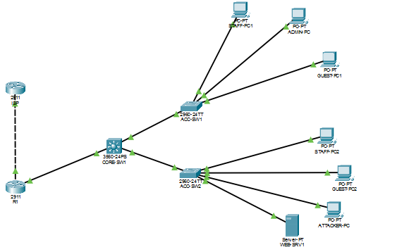

# Secure Campus Network: Cisco Packet Tracer

A segmented campus network built in Cisco Packet Tracer with an edge router doing NAT, a Layer 3 core switch doing inter-VLAN routing and DHCP, two access switches, and layered security: port security, DHCP snooping, Dynamic ARP Inspection (DAI) and inter-VLAN ACLs.

## Topology


```
                 ISP (2911)  Lo0 8.8.8.8
                     | Gi0/0  203.0.113.2/30
                     | (cross-over)
                     | Gi0/1  203.0.113.1/30
                 R1 (2911, NAT)
                     | Gi0/0  10.0.0.2/30
                     | Gi0/1  10.0.0.1/30
               CORE-SW1 (3560-24PS, L3 + DHCP)
                 |                    |
            Fa0/23                  Gi0/2
                 |                    |
         ACC-SW1 (Gi0/1)       ACC-SW2 (Gig0/2)
```

## Addressing

| Device | Interface | Address |
| --- | --- | --- |
| ISP | Gi0/0, Lo0 | 203.0.113.2/30, 8.8.8.8/32 |
| R1 | Gi0/1 (outside), Gi0/0 (inside) | 203.0.113.1/30, 10.0.0.2/30 |
| CORE-SW1 | Gi0/1 (routed) | 10.0.0.1/30 |
| ACC-SW1 | VLAN 99 | 192.168.99.11/24 |
| ACC-SW2 | VLAN 99 | 192.168.99.12/24 |

## VLANs

| VLAN | Name | Subnet | Gateway (CORE-SW1 SVI) | Access ports |
| --- | --- | --- | --- | --- |
| 10 | USERS | 192.168.10.0/24 | 192.168.10.1 | Fa0/1 to Fa0/8 |
| 20 | SERVERS | 192.168.20.0/24 | 192.168.20.1 | Fa0/9 to Fa0/16 |
| 30 | GUEST | 192.168.30.0/24 | 192.168.30.1 | Fa0/17 to Fa0/22 |
| 99 | MGMT | 192.168.99.0/24 | 192.168.99.1 | management only |

CORE-SW1 is the DHCP server for VLANs 10, 20 and 30, with the first ten addresses of each subnet excluded.

## Endpoints

| Host | Switch / port | VLAN | Address |
| --- | --- | --- | --- |
| STAFF-PC1 | ACC-SW1 Fa0/1 | 10 | 192.168.10.11 (DHCP) |
| ADMIN-PC | ACC-SW1 Fa0/2 | 10 | 192.168.10.12 (DHCP) |
| GUEST-PC1 | ACC-SW1 Fa0/17 | 30 | 192.168.30.11 (DHCP) |
| ATTACKER-PC | ACC-SW2 Fa0/1 | 10 | 192.168.10.14 (DHCP) |
| STAFF-PC2 | ACC-SW2 Fa0/2 | 10 | 192.168.10.13 (DHCP) |
| WEB-SRV1 | ACC-SW2 Fa0/9 | 20 | 192.168.20.10 (static) |
| GUEST-PC2 | ACC-SW2 Fa0/17 | 30 | 192.168.30.12 (DHCP) |

## Routing and NAT

- CORE-SW1 runs `ip routing` and has a default route to R1 (10.0.0.2).
- R1 has a default route to the ISP (203.0.113.2) and a return route for 192.168.0.0/16 via the core (10.0.0.1).
- R1 uses PAT (`ip nat inside source list 1 interface Gi0/1 overload`) so all internal VLANs share 203.0.113.1.

## Security controls

### Layer 2 (access switches)

- **Port security** on user ports: maximum 1 MAC, sticky learning, violation mode shutdown.
- **DHCP snooping** on VLANs 10, 20 and 30, with only the uplink trusted. This blocks rogue DHCP offers.
- **Dynamic ARP Inspection** on VLANs 10, 20 and 30 with source MAC, destination MAC and IP validation. Uplinks are trusted, and WEB-SRV1's port is trusted because it uses a static address.
- **Unused ports** (Gig0/1 on ACC-SW2, Gig0/2 on ACC-SW1) are administratively shut down.

### Layer 3 (CORE-SW1 inbound ACLs on each SVI)

| VLAN | Policy |
| --- | --- |
| 30 (guest) | Internet only. Denied to staff, servers, management and the R1 link. |
| 10 (staff) | Internet, plus web (80/443) and ping to the server. Denied to guests and management. ADMIN-PC (192.168.10.12) is the only host allowed to reach management. |
| 20 (servers) | Replies only (established TCP, echo-reply). Cannot initiate connections to staff, guests or management. Internet access kept. |

## Verification

| Test | Result |
| --- | --- |
| STAFF-PC1 gets a DHCP lease and pings 8.8.8.8 | Pass (NAT through R1 to ISP) |
| GUEST-PC1 to 8.8.8.8 | Pass |
| GUEST-PC1 to staff, server, management, R1 link | Blocked by VLAN30-IN |
| STAFF-PC1 to server (ping, HTTP) | Pass |
| STAFF-PC1 to guests and management | Blocked by VLAN10-IN |
| ADMIN-PC to management | Pass (host-specific permit) |
| WEB-SRV1 to staff, guests, management | Blocked by VLAN20-IN |
| Second device on a protected port | Port went `Secure-shutdown`, violation count 1 |
| DHCP snooping binding tables | Populated on both access switches |

ACL behavior is confirmed by the match counters in `show access-lists`.

## Known limitation

DAI was configured and shows `Active` on VLANs 10, 20 and 30, but Packet Tracer did not enforce it. The inspection counters stayed at 0 and a spoofed static address could still ping the gateway. Packet Tracer's 2960 also does not support ARP access lists, so the static server is exempted by trusting its port. On real hardware an ARP ACL or static binding would be used instead.

## Files

- `secure-campus-network.pkt`: the Packet Tracer project
- `configs/`: `show running-config` for ISP, R1, CORE-SW1, ACC-SW1 and ACC-SW2
- `screenshots/`: verification output for routing, NAT, DHCP, snooping, port security, DAI and ACL hit counts
